# Sumi

**A calm, offline Sudoku for Android that teaches you as you play.**

Sumi is the black ink of Japanese calligraphy. Printed clues are set in sumi black on washi paper, your own numbers in indigo, the selected cell in gold, mistakes in vermilion (the colour calligraphy teachers correct work in), and a finished row, column or box in matcha green. A solved puzzle gets a hanamaru, the flower circle Japanese teachers draw on top marks.

Built with Kotlin and Jetpack Compose. No ads, no account, no permissions.

<table>
  <tr>
    <td>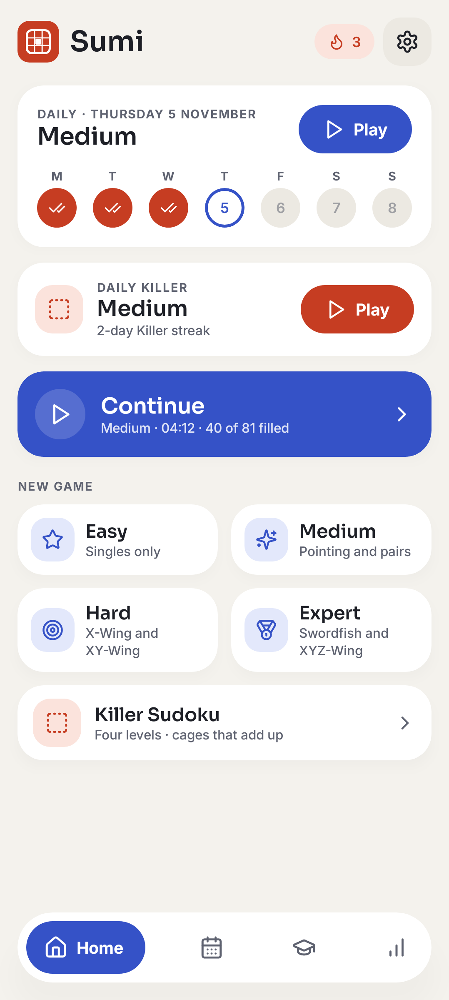</td>
    <td>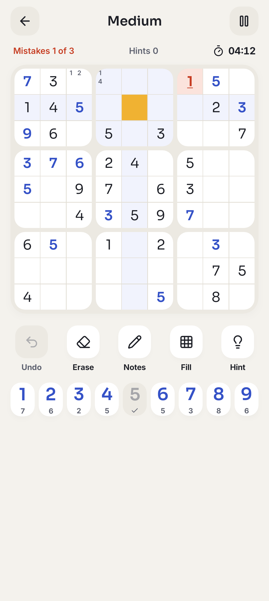</td>
    <td>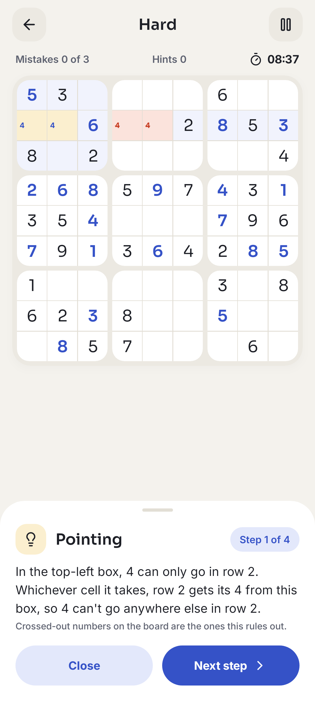</td>
    <td>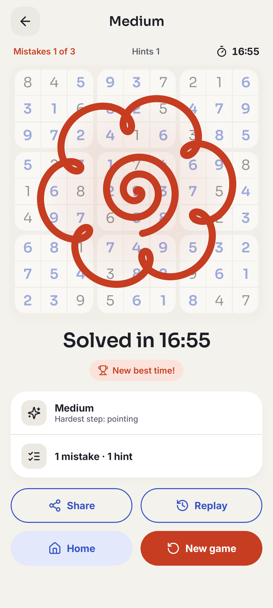</td>
  </tr>
  <tr>
    <td align="center">Home</td>
    <td align="center">Playing</td>
    <td align="center">A teaching hint</td>
    <td align="center">Solved</td>
  </tr>
  <tr>
    <td>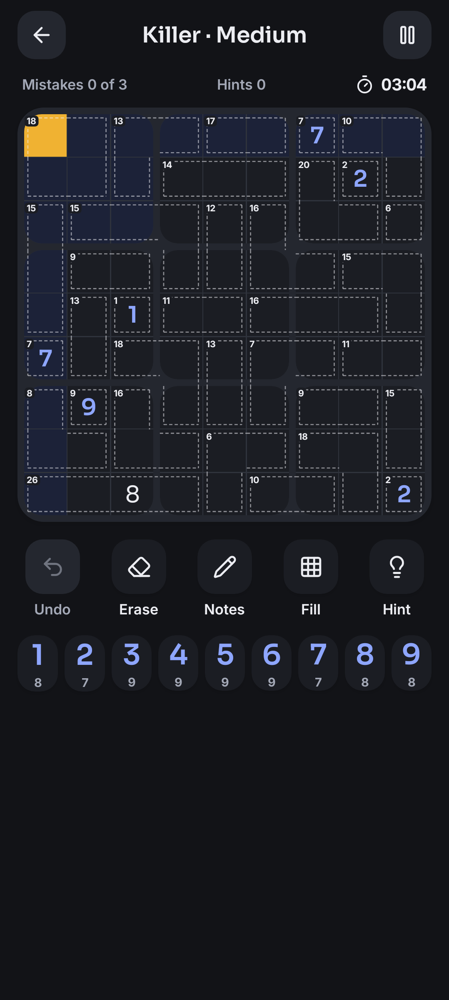</td>
    <td>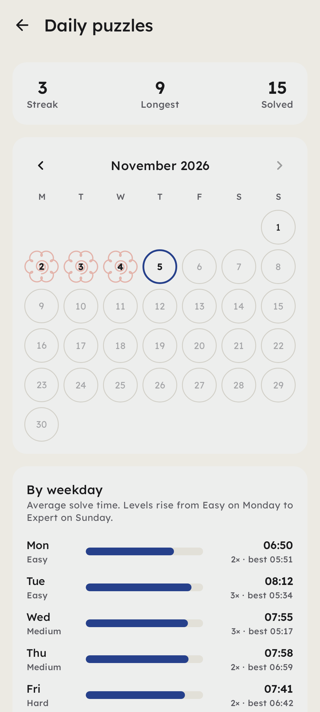</td>
    <td>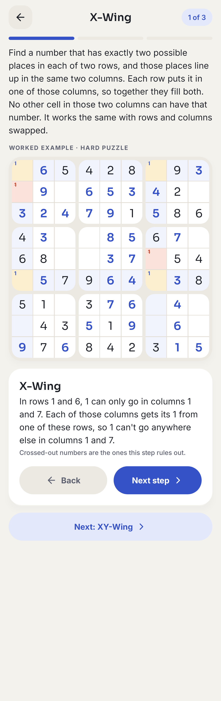</td>
    <td>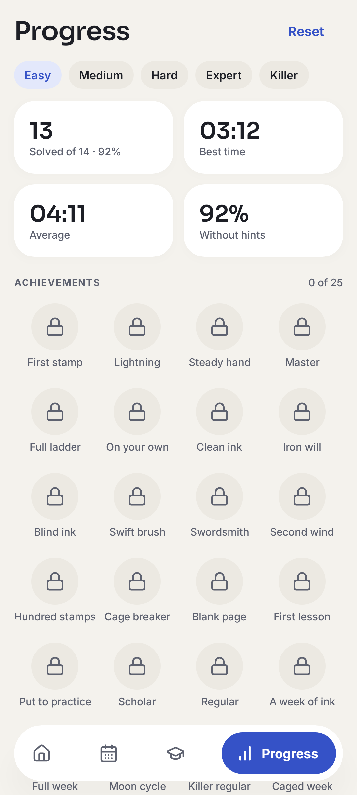</td>
  </tr>
  <tr>
    <td align="center">Killer, dark</td>
    <td align="center">Daily puzzles</td>
    <td align="center">Learn</td>
    <td align="center">Progress</td>
  </tr>
</table>

## Install

On your Android phone (Android 8 or newer), open

**https://github.com/kiai-joe/sudoku/releases/latest/download/Sumi.apk**

and install it, allowing "Install unknown apps" for your browser when asked. Newer versions install over older ones and keep your games, streaks and stats.

## Features

### Puzzles

- **Four levels graded by technique, not clue count.**
  - Easy: singles only.
  - Medium: pointing, box/line reduction, pairs and naked triples.
  - Hard: hidden triples, X-Wing, XY-Wing and naked quads.
  - Expert: Swordfish, XYZ-Wing and hidden quads.

  Every puzzle is generated on the phone, has exactly one solution, and can be solved by logic without guessing.
- **Killer Sudoku.** The grid is split into dashed cages, each showing the sum of its cells, and no number repeats inside a cage. Killer has its own four levels:
  - Easy: cage combinations.
  - Medium: the 45 rule, with innies and outies.
  - Hard: classic techniques too.
  - Expert: the same with no printed numbers at all.
- **Daily puzzles.** There are two each day, the same for everyone, made from the date so they work offline. The classic one rises from Easy on Monday to Expert on Sunday, and so does a daily Killer. Each has its own streak and calendar, and neither replaces your regular game.

### Playing

- **Pencil notes.** Matching notes clear when you place a number, and **Fill** pencils in every number still possible.
- **Help on the board.** The selected cell's row, column, box and matching numbers are highlighted. Undo and erase are always there.
- **Mistakes.** There's a limit of 3, which you can turn off. Turn off *Show mistakes right away* and nothing gives away whether a number is right until you tap **Check**.
- **Finishing touches.** A matcha ink wash runs across every row, column or box you finish. Gentle vibrations mark each move, with a longer pattern for a win or a loss. Vibrations use the phone's own haptics, so they need no permission.
- **Timer.** It pauses when you leave, and a manual pause hides the board.
- **Saving.** The game is saved after every move.

### Learning

- **Teaching hints.** A hint finds the easiest next step on your board, highlights the cells involved, and explains it in plain words ("In the centre box, 4 can only go in row 5…"). Candidates a step rules out are crossed out on the board. A wrong number is pointed out first. On a phone the hint slides up as a sheet, so the board stays in view.
- **Lessons.** There's a lesson for every technique, each with a worked example from a real puzzle that you step through on the board. Learn tracks which lessons you've finished.
- **A Killer course.** Nine lessons take you from the rules through cages with one answer, the last cell of a cage, cage combinations and how they meet the grid, to the 45 rule (innies, outies, and across several rows) and classic techniques in Killer.
- **Combinations cheat sheet.** Every way to make each sum in 2 to 5 cells, with the one-answer sums marked and the numbers a sum always uses. Open it from Learn, or from the Σ button in any Killer game, where it opens on the size of the selected cell's cage.
- **Practice.** **Practise on a new puzzle** starts a fresh puzzle that needs the lesson's technique.

### Progress

- **Stats per level.** Games played and solved, win rate, best and average time, and how often you solve without hints.
- **25 achievements, shown as seals.** They range from a first solve to a 30-day streak. There are fast and clean solves, an Expert with mistakes hidden, a Swordfish puzzle, 100 solves, every lesson, a full Monday-to-Sunday week, and daily Killer streaks.
- **A new phone keeps your progress.** Android's backup and phone-to-phone transfer include your progress, or you can save and restore a backup file from Settings.

### After a game

- **Share your result.** The win screen's Share button sends a short summary through Android's share sheet: the puzzle, your time, mistakes and hints, and for a daily puzzle that week as a row of red squares with your streak, so friends playing the same daily can compare.
- **Replay.** Watch your solve back move by move, with play, a step either way and a slider. Below the board, the moments worth a look jump straight there: wrong numbers, numbers a hint placed, and your three longest pauses. Every game keeps a log of its board changes for this, saved with the game.

### Home-screen widgets

- **Daily puzzle (4×2).** Today's level, your streak and this week, with a button that opens straight into today's puzzle.
- **Streak (2×1).** Your streak and a round Play button.
- **Daily Killer (4×2).** The same for the daily Killer: its level, its own streak and this week, with a button straight into today's Killer.

### Look, comfort and access

- **Three palettes.** Sumi (washi by day, sumi night after dark), Indigo night (always dark) and Bamboo. Light, dark or follow the phone.
- **Tablets and landscape.** The board sits beside the controls. On a tablet the number pad is a 3×3 grid of bigger keys.
- **Accessibility.**
  - A Larger numbers setting.
  - Mistakes are underlined as well as red, so they don't rely on colour.
  - Every cell is fully described to screen readers.
  - Animations stop when the system's Remove animations setting is on.

## Languages

Sumi speaks **English** and **Swahili (Kiswahili)**. It follows the phone's language, and on Android 13 or newer you can set Sumi's language on its own (Settings › Apps › Sumi › Language). Everything is translated, including hint explanations, lessons and achievements.

<table>
  <tr>
    <td>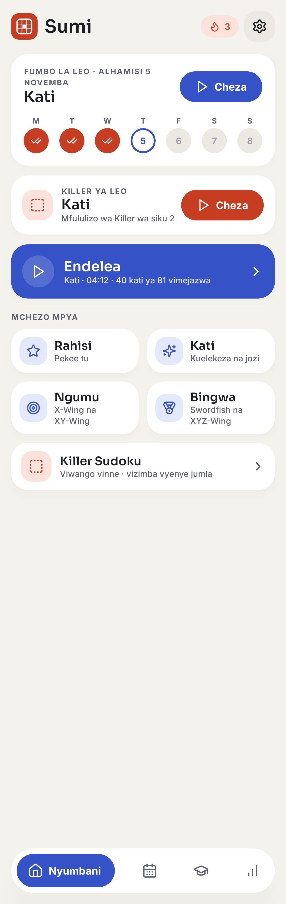</td>
    <td>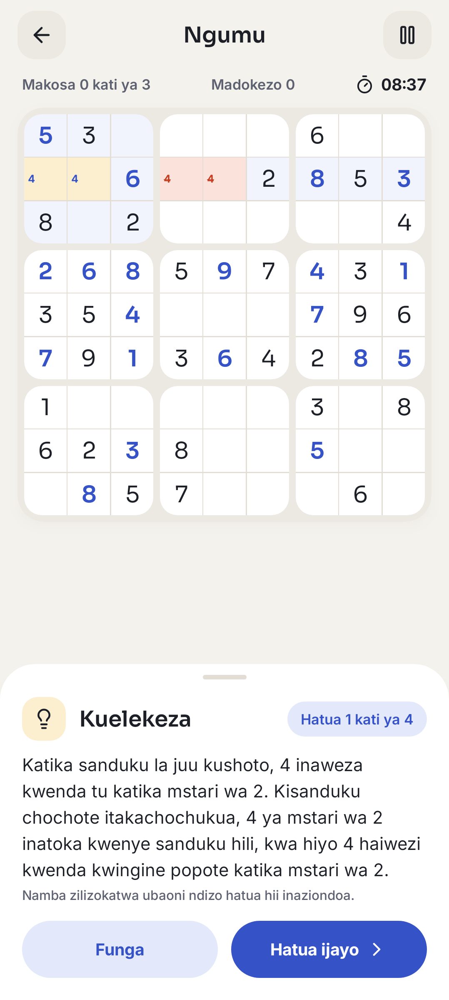</td>
    <td>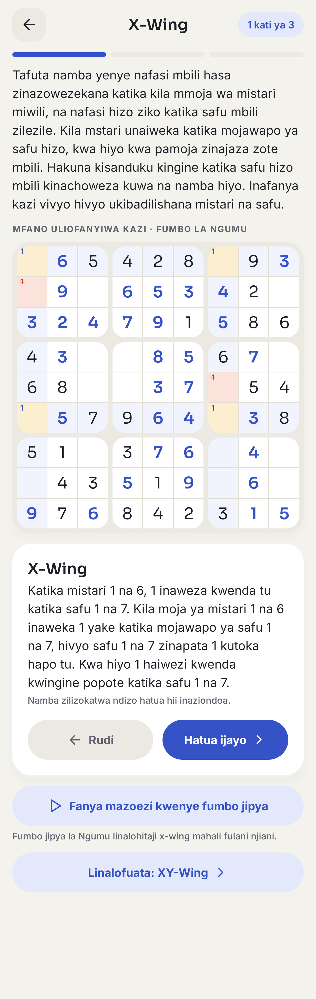</td>
  </tr>
</table>

Each piece of text is written in the code as `tr("English", "Kiswahili")`, so a translation sits next to the English it comes from. `LangTest` plays real games in Swahili and fails if any English is left in a hint or lesson. Corrections from native speakers are very welcome.

## Privacy

Sumi collects nothing, works entirely offline and has no ads. It asks for no Android permissions, not even internet access. See the [privacy policy](docs/privacy-policy.md). `PrivacyTest` fails if a permission is ever added, so the policy stays true.

## Development

### Build and test

You need Android Studio (Ladybug or newer), or JDK 17 with the Android SDK.

```bash
./gradlew testDebugUnitTest
```

```bash
./gradlew assembleDebug
```

The first command runs the unit tests: the engine, accessibility, backup, widgets and languages. The second builds the APK at `app/build/outputs/apk/debug/app-debug.apk`.

### Screenshots

`ScreenshotTest` renders every main screen to `app/src/test/screenshots`, in light and dark, the other palettes, landscape, tablet and Swahili. It uses [Roborazzi](https://github.com/takahirom/roborazzi) on Robolectric, so no device is needed. On every pull request CI re-renders them and commits any changes back to the branch, so visual changes show up as image diffs in the review.

```bash
./gradlew recordRoborazziDebug
```

### Releases

The **Release APK** workflow publishes a GitHub release with `Sumi.apk` attached:

- a push to `main` makes a `build-N` release
- running the workflow by hand (Actions › Release APK › Run workflow) does the same for the chosen branch
- a tag such as `v0.2.0` makes a release with that version name

APKs are signed with the debug key in `app/signing/debug.keystore`, so every build can update the last one. This key is not secret; publishing on Google Play needs a separate private key.

### Project layout

```
app/src/main/java/com/kiaijoe/sudoku/
├── engine/          Pure Kotlin game logic, no Android dependencies
│   ├── Grid.kt          Cell indexing, peers, solution check
│   ├── Solver.kt        Bitmask backtracking solver and solution counter
│   ├── LogicSolver.kt   Human-style solver that grades puzzles by technique
│   ├── Generator.kt     Graded, unique-solution puzzle generator and levels
│   ├── Killer.kt        Killer cages, cage combinations and the Killer generator
│   ├── Hints.kt         Turns solver steps into explained, step-by-step hints
│   ├── Tutorial.kt      Lessons, worked examples and practice puzzles
│   ├── Daily.kt         Daily puzzles from the date, weekly levels, streaks
│   ├── Achievements.kt  Achievements and the rules for earning them
│   ├── Lang.kt          English and Swahili text
│   ├── GameState.kt     Immutable game state and moves
│   └── GameCodec.kt     Save format
├── data/            Saved games, settings, stats and backup files
├── widget/          Home-screen widgets
└── ui/              ViewModel, theme, icons, board, controls and screens
```

### How puzzles are graded

`LogicSolver` solves with pencil-mark candidates the way a person does, always using the easiest technique that makes progress. The hardest technique it needs sets the level. The generator digs clues out of a random grid while the solution stays unique, grades the result, and where logic gets stuck adds back the clue that lands the puzzle on the requested level. Easy puzzles keep at least 34 clues. A puzzle takes about 0–75 ms to generate on a desktop JVM, with Expert the slowest.

## Credits

- Fonts: [Sora](https://github.com/sora-xor/sora-font) for titles and numbers, and [Inter](https://rsms.me/inter/) for text. Both are under the SIL Open Font License (`licenses/Sora-OFL.txt`, `licenses/Inter-OFL.txt`).
- Icons: [Lucide](https://lucide.dev) outlines, ISC licence (`licenses/Lucide-ISC.txt`). They're compiled into the app as vectors in `ui/icons/Lucide.kt`.
